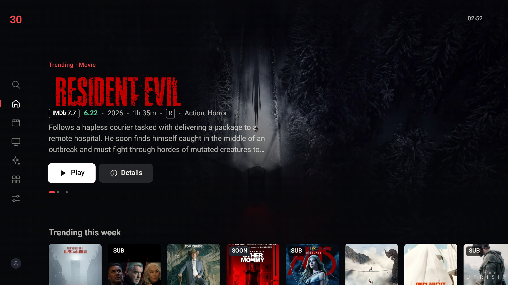
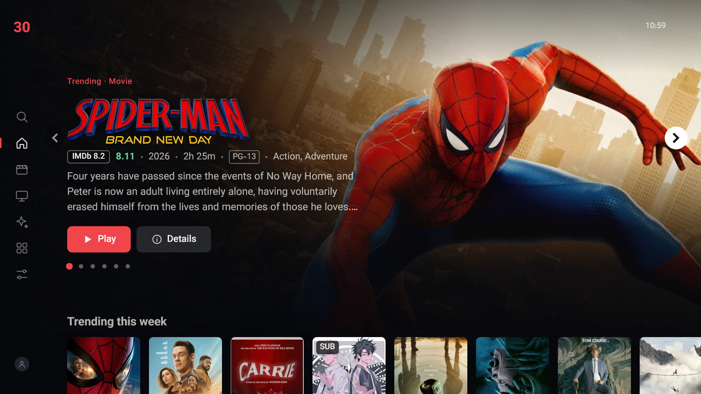
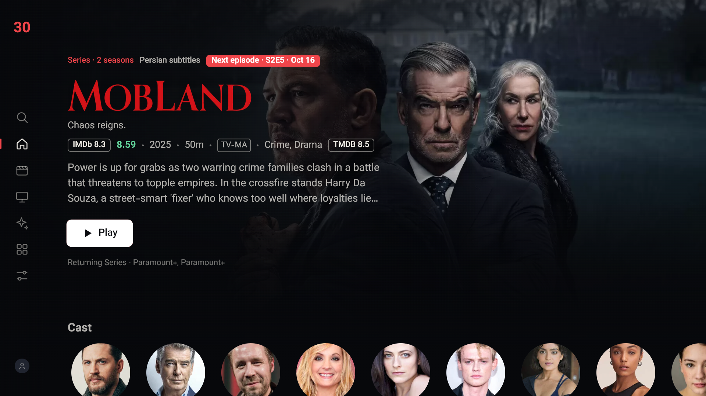
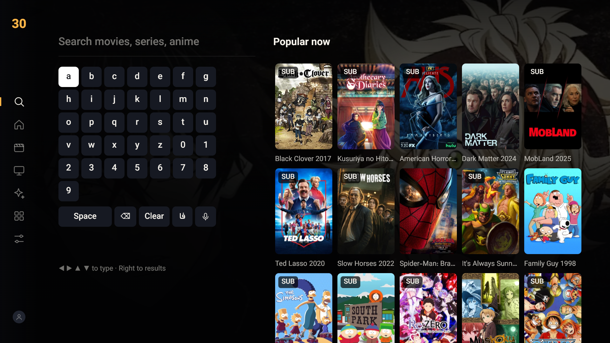

# 30nama for LG webOS TV

An LG webOS TV app: an unofficial client for 30nama.com. It is a port of [30nama-tizenos](https://github.com/msharifi99/30nama-tizenos) (the Samsung Tizen app) with the same UI and features.

> **Disclaimer:** This is an unofficial, community project. It is not affiliated with, endorsed by, or supported by 30nama. You need your own valid 30nama subscription to use it. No content is bundled with this app.

## Features

- Sign in by scanning a QR code with your phone
- TV UI: hero banner, rows, details pages, search, remote-friendly navigation
- Works with the D-pad and with the Magic Remote pointer
- webOS native player (HLS, plus direct mkv/mp4 download files at max quality), with hls.js as a fallback
- Persian (fa) and English (en) subtitles
- Persian UI with full right-to-left support
- Optional TMDB enrichment: trending rows, cast and crew, reviews, recommendations

## Screenshots

| Home | Browse |
|---|---|
|  |  |
| **Details** | **Search** |
|  |  |

## Install on an LG webOS TV

Works on LG TVs with webOS 22 or newer (2022+ models). You need a computer (Windows, macOS or Linux) on the same network as the TV, once.

### Step 1: Turn on Developer Mode on the TV (one time)

1. On your computer, create a free LG developer account at [webostv.developer.lge.com](https://webostv.developer.lge.com) (**Sign In → Create Account**).
2. On the TV press **Home**, open **Apps** (LG Content Store on older models), search for **Developer Mode** and install it.
   If it doesn't show up, set **Settings → General → Location → LG Services Country** to a region such as the United States and try again.
3. Open **Developer Mode**, sign in with the account from step 1 and switch **Dev Mode Status** on. The TV restarts.
4. Open **Developer Mode** again and switch **Key Server** on. Keep this screen open: it shows the TV's **IP address** and a **passphrase**.

### Step 2: Install the app

**Option A: webOS Dev Manager (easiest, no command line)**

1. Download the latest `com.nama30.webos_*_all.ipk` from [Releases](https://github.com/EmadBeyrami/30nama-WebOS/releases/latest).
2. Install [webOS Dev Manager](https://github.com/webosbrew/dev-manager-desktop/releases/latest) on your computer.
3. In Dev Manager choose **Add device**, enter the TV's **IP address**, keep the defaults (port 9922, user `prisoner`), and enter the **passphrase** when asked.
4. Open the **Apps** tab and drag the `.ipk` file into it (or use **Install**).
5. On the TV, open **30nama** from the app list.

**Option B: command line**

Requires Node 18+.

```
npm install -g @webos-tools/cli
ares-setup-device -a tv -i "host=<TV_IP>" -i "port=9922" -i "username=prisoner"
ares-novacom --device tv --getkey        # enter the passphrase shown on the TV
ares-install -d tv com.nama30.webos_<version>_all.ipk
ares-launch -d tv com.nama30.webos
```

**Option C: build from source**

```
git clone https://github.com/EmadBeyrami/30nama-WebOS.git && cd 30nama-WebOS
npm install                              # installs the webOS CLI locally
npx ares-setup-device -a tv -i "host=<TV_IP>" -i "port=9922" -i "username=prisoner"
npx ares-novacom --device tv --getkey    # enter the passphrase shown on the TV
./build.sh tv                            # builds the .ipk, installs and launches it
```

### Step 3: Use it

The app stays in the TV's app list; open it like any other app. You only repeat Step 2 to update to a new release.

**Developer Mode has a timer.** When it runs out, Dev Mode turns off and the app is removed. Open the Developer Mode app now and then and press **Extend Session Time**, or let GitHub do it automatically (next section). If the app ever disappears, turn Dev Mode on again and repeat Step 2.

### Homebrew Channel (rooted TVs)

On a rooted TV with the [Homebrew Channel](https://github.com/webosbrew/webos-homebrew-channel) there is no Dev Mode timer; install the `.ipk` with Dev Manager as above. Each release also includes `30nama.manifest.json`, the Homebrew Channel app manifest (id, version, ipk URL, sha256), which is what [webosbrew/apps-repo](https://github.com/webosbrew/apps-repo) needs to list the app.

## Keep Developer Mode alive

A daily GitHub Actions job ([`devmode-renew.yml`](.github/workflows/devmode-renew.yml)) resets your TV's Dev Mode timer through LG's developer API, so the app is never removed. The TV does not need to be on.

1. Fork this repo (or use your own copy) and run `gh auth login`.
2. With the TV registered as in Option B or C, run `tools/devmode-secret.sh tv`. It reads the session token from the TV and saves it as the `WEBOS_DEVMODE_TOKEN` repository secret (the token is never printed).
3. Optionally run the workflow once from the Actions tab to check it.

If Developer Mode is ever switched off and on again, the token changes: run `tools/devmode-secret.sh tv` again. GitHub pauses scheduled workflows in repos with no activity for 60 days and emails you first; re-enable it from the Actions tab.

## Optional: TMDB setup

TMDB adds trending rows, cast, reviews and recommendations. It is off by default and the app works fully without it. You can turn it on from the app itself:

1. Create a free account at themoviedb.org and open Settings, API. Copy your **API Key** (32 characters) or the longer **API Read Access Token**.
2. On the TV open **Settings > TMDB metadata**. The page also shows a QR code that opens your TMDB API settings on your phone.
3. Enter the key and choose **Check and save**. The 32-character API Key is easy to type with the on-screen keypad. For the long Read Access Token use **Keyboard**.
4. The app checks the key with TMDB and shows **Connected**. Use **Remove key** to turn it off again, or **Clear metadata cache** to refresh the data.

The key is stored only on your TV.

**Build-from-source alternative.** To bake a token into your own build, copy `webos-app/js/tmdb-token.example.js` to `webos-app/js/tmdb-token.js`, paste the token, and rebuild. A key set in Settings overrides it. Never commit this file or share a build that contains it.

## Development

Run the app in a desktop browser with a small proxy (no dependencies, Node 18+):

```
npm run dev        # = node webos-app/tools/devserver.js 8080
```

Then open http://localhost:8080/. The proxy forwards API and HLS requests to avoid CORS. Arrow keys, Enter and Backspace/Escape (= Back) work. See `webos-app/README.md` for developer notes and `design/DESIGN.md` for the design spec.

Offline UI regression test (Playwright + local Chrome): `npm install --no-save playwright && npm run test:ui`.

## Differences from the Tizen app

| Tizen | webOS |
|---|---|
| Samsung AVPlay player | webOS native `<video>` pipeline (HLS + mkv/mp4), hls.js fallback if native HLS fails |
| `config.xml`, `.wgt`, Tizen Studio | `appinfo.json`, `.ipk`, `@webos-tools/cli` (`ares-package`) |
| TizenBrew module | Homebrew Channel manifest |
| Back key 10009, `tvinputdevice.registerKey` | Back key 461 (`disableBackHistoryAPI`), no key registration needed |
| Remote button takeover (Tizen background service) | Not available: webOS doesn't let apps watch other apps without root |
| D-pad only | D-pad plus Magic Remote pointer |

## Structure

```
webos-app/    the webOS web app (appinfo.json, index.html, js/, css/, fonts/, tools/)
design/       design spec
docs/         README screenshots
tests/        offline UI regression test
tools/        release helpers (Homebrew Channel manifest) and the Dev Mode token helper
media/        512 px icon for the Homebrew Channel listing
.github/      workflows: release (labelled merges to main build an .ipk + manifest), daily Dev Mode renewal
build.sh      package (and optionally install) with ares-cli
```

## License

Released under the [MIT License](LICENSE). The Vazirmatn font in `webos-app/fonts/` is licensed under the SIL Open Font License (see `webos-app/fonts/OFL.txt`).

## Compatibility

| LG TV | webOS | Chromium | Validation |
|---|---|---|---|
| 2025 OLED | 10.3 | 120 | English/Persian UI and playback checked; installed and launched on a physical TV |

Targets webOS 22 and later (2022+ TVs, Chromium 87+); the CSS sticks to the Chromium 85 feature set like the Tizen app. Older webOS versions (6.x, Chromium 79) lack flexbox `gap` and may show spacing glitches.

Browser versions: [webOS TV web engine](https://webostv.developer.lge.com/develop/specifications/web-api-and-web-engine).
